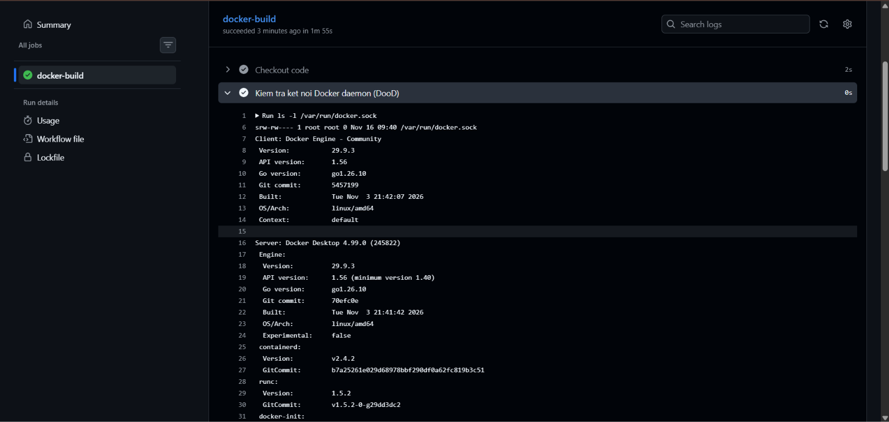
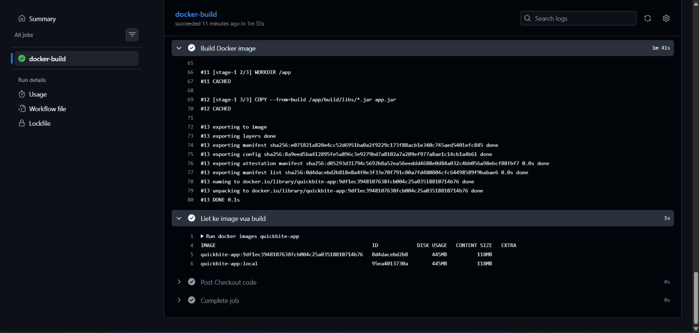
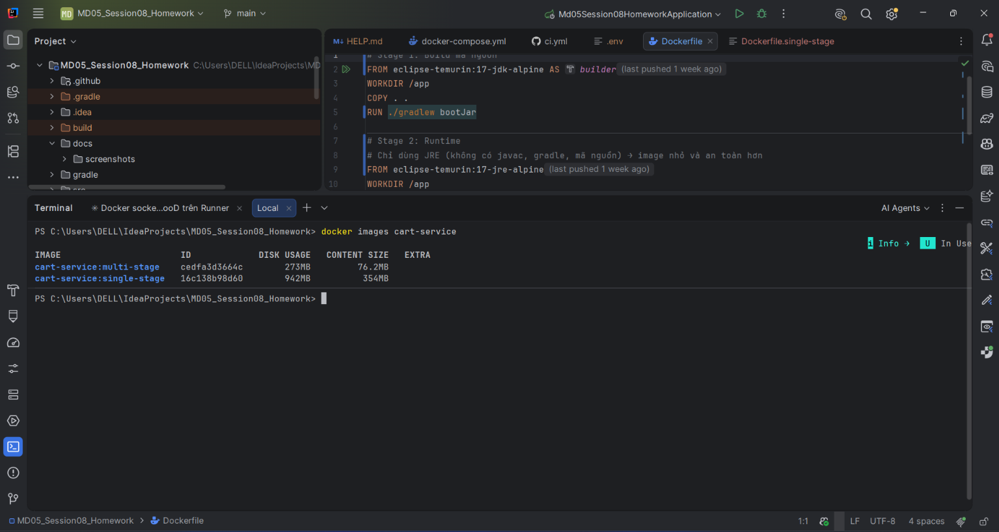
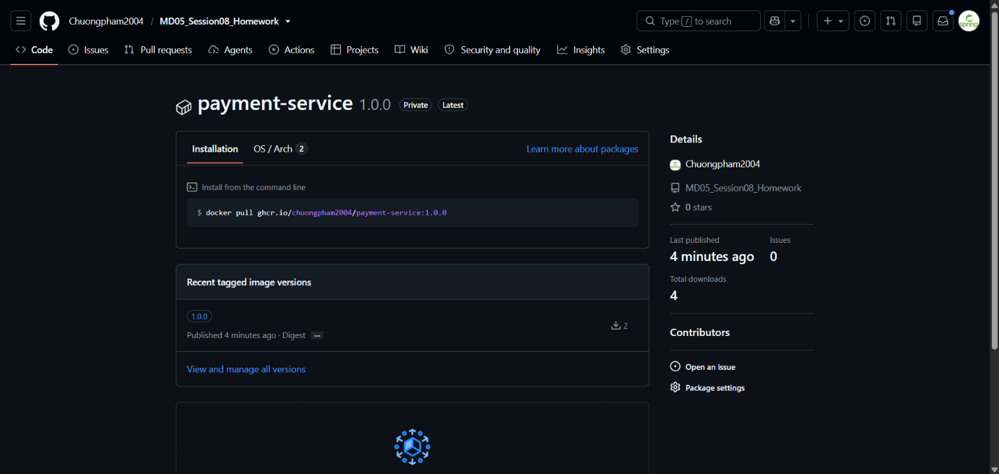
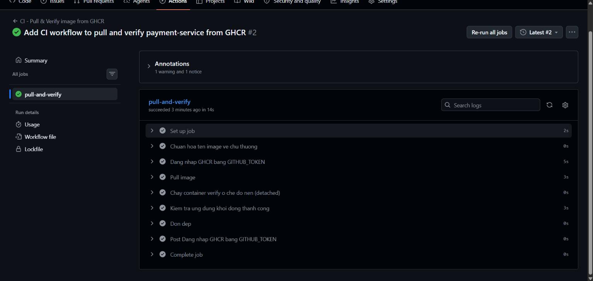
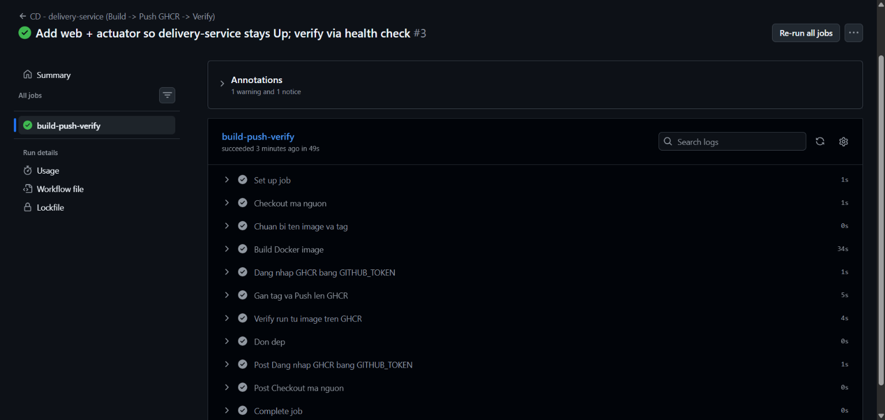
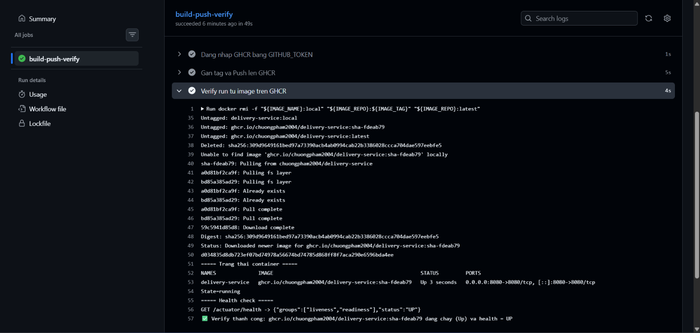

# MD05 – Session 08: Docker CI/CD với GitHub Actions & GHCR

Bộ bài tập về Docker-outside-of-Docker, Multi-stage build, GitHub Container Registry (GHCR)
và luồng CI/CD tự động cho các service của QuickBite.

[](https://github.com/Chuongpham2004/MD05_Session08_Homework/actions/workflows/main.yml)
[](https://github.com/Chuongpham2004/MD05_Session08_Homework/actions/workflows/ci.yml)

## Mục lục bài nộp

| Bài | Chủ đề | File chính | Minh chứng |
|-----|--------|------------|------------|
| 1 | Sửa lỗi chia sẻ Docker socket (DooD) | [`docker-compose.yml`](docker-compose.yml) | [Run #44113901072](https://github.com/Chuongpham2004/MD05_Session08_Homework/actions/runs/44113901072) |
| 2 | Hoàn thiện Dockerfile Multi-stage | [`Dockerfile`](Dockerfile) | [Ảnh so sánh dung lượng](docs/screenshots/03-multi-stage-size-comparison.png) |
| 3 | Build & Push image lên GHCR bằng PAT | [`docs/bai3-ghcr-push.md`](docs/bai3-ghcr-push.md) | [Package `payment-service`](https://github.com/users/Chuongpham2004/packages/container/package/payment-service) |
| 4 | CI tự động Pull image từ GHCR | [`.github/workflows/ci.yml`](.github/workflows/ci.yml) | [Run #44122783037](https://github.com/Chuongpham2004/MD05_Session08_Homework/actions/runs/44122783037) |
| 5 | Phân tích sự cố mất cache Gradle | [PDF](docs/bai5-phan-tich-mat-cache.pdf) · [Word](docs/bai5-phan-tich-mat-cache.docx) | Báo cáo RCA |
| 6 | Pipeline CI/CD hoàn chỉnh | [`.github/workflows/main.yml`](.github/workflows/main.yml) | [Package `delivery-service`](https://github.com/users/Chuongpham2004/packages/container/package/delivery-service) · [Lịch sử Actions](https://github.com/Chuongpham2004/MD05_Session08_Homework/actions/workflows/main.yml) |

---

## Bài 1 – Sửa lỗi cấu hình chia sẻ Docker Socket (DooD)

- **Lỗi:** `Cannot connect to the Docker daemon at unix:///var/run/docker.sock`. Container Runner không có
  Docker daemon riêng và không nhìn thấy socket của host.
- **Cách sửa:** mount socket của host vào container Runner trong [`docker-compose.yml`](docker-compose.yml):
  `- /var/run/docker.sock:/var/run/docker.sock`.
- **Workflow:** [`.github/workflows/bai1-dood.yml`](.github/workflows/bai1-dood.yml) (chạy tay trên self-hosted runner).
- **Kết quả:** [Run thành công](https://github.com/Chuongpham2004/MD05_Session08_Homework/actions/runs/44113901072)

| Kết nối daemon | Build image |
|---|---|
|  |  |

## Bài 2 – Hoàn thiện Dockerfile Multi-stage Build

- Stage 2 dùng `eclipse-temurin:17-jre-alpine` và `COPY --from=builder /app/build/libs/*.jar app.jar`.
- Bản đối chứng không dùng multi-stage: [`Dockerfile.single-stage`](Dockerfile.single-stage).

| Image | Content size | Disk usage |
|---|---|---|
| `cart-service:single-stage` (JDK) | 354 MB | 942 MB |
| `cart-service:multi-stage` (JRE) | **76.2 MB** (−78%) | 273 MB |



## Bài 3 – Build và Push image lên GHCR

- Các câu lệnh CLI và phân tích lỗi `denied`: [`docs/bai3-ghcr-push.md`](docs/bai3-ghcr-push.md)
- PAT (classic) chỉ cấp scope `write:packages`; tag đúng chuẩn `ghcr.io/chuongpham2004/payment-service:1.0.0`.
- Package: https://github.com/users/Chuongpham2004/packages/container/package/payment-service



## Bài 4 – CI tự động Pull image từ GHCR

- Workflow: [`.github/workflows/ci.yml`](.github/workflows/ci.yml)
- Đăng nhập bằng `secrets.GITHUB_TOKEN`, khai báo `permissions: packages: read`,
  chuyển owner về chữ thường bằng `${GITHUB_REPOSITORY_OWNER,,}`.
- Cấp quyền **Read** cho repo trong *Package settings → Manage Actions access*
  (khắc phục lỗi `403 Forbidden` ở lần chạy đầu).
- **Kết quả:** [Run thành công trong 14 giây](https://github.com/Chuongpham2004/MD05_Session08_Homework/actions/runs/44122783037)



## Bài 5 – Phân tích sự cố mất Cache trong Multi-stage CI/CD

Báo cáo nguyên nhân gốc rễ: [PDF](docs/bai5-phan-tich-mat-cache.pdf) · [Word](docs/bai5-phan-tich-mat-cache.docx)

Tóm tắt: Gradle trong Stage 1 chạy bên trong một container builder tạm thời và bị cô lập, nên không thấy
`~/.gradle` của Runner. DooD chỉ chia sẻ kênh điều khiển (socket), không chia sẻ hệ thống file.
`COPY . .` đứng trước `RUN` cũng làm mất layer cache mỗi khi mã nguồn thay đổi.

## Bài 6 – Pipeline CI/CD hoàn chỉnh cho `delivery-service`

- Workflow: [`.github/workflows/main.yml`](.github/workflows/main.yml). Một job gồm các bước tuần tự:
  1. Checkout mã nguồn
  2. Build image từ [`Dockerfile`](Dockerfile) multi-stage
  3. Đăng nhập GHCR bằng `GITHUB_TOKEN` (`permissions: packages: write`)
  4. Gắn tag `sha-<commit>` và `latest`, push lên GHCR
  5. Xoá image local, pull lại từ GHCR, chạy container nền và kiểm tra `/actuator/health`
- Package: https://github.com/users/Chuongpham2004/packages/container/package/delivery-service
- Lịch sử chạy: https://github.com/Chuongpham2004/MD05_Session08_Homework/actions/workflows/main.yml

| Pipeline | Verify: container `Up`, health `UP` |
|---|---|
|  |  |

---

## Chạy thử tại máy

```bash
# Build và chạy service
docker build -t delivery-service .
docker run -d -p 8080:8080 --name delivery-service delivery-service
curl http://localhost:8080/actuator/health

# Self-hosted runner (Bài 1): tạo .env từ .env.example rồi
docker compose up -d
```
