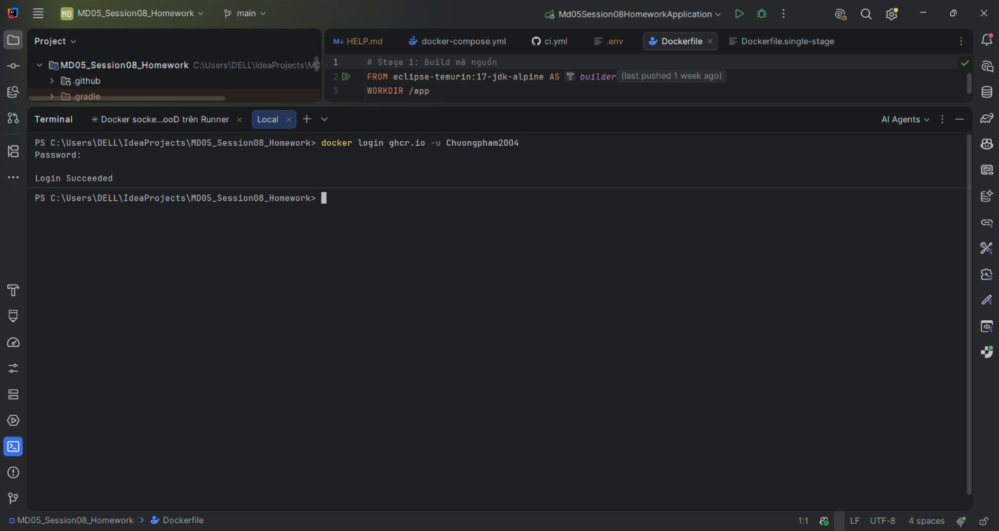
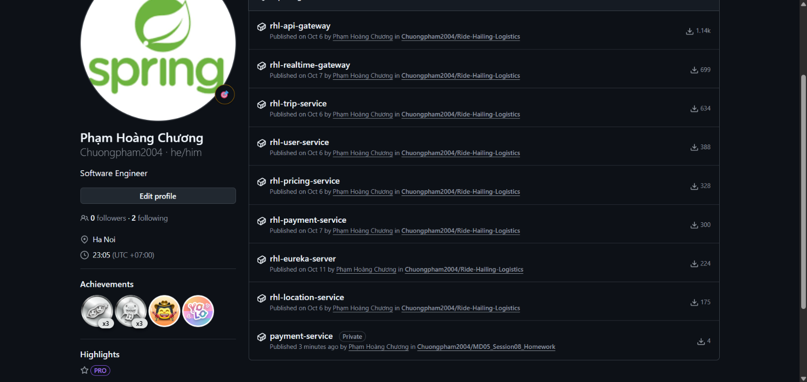

# Bài 3: Build và Push image `payment-service` lên GHCR

## 1. Phân tích lỗi `denied: requested access to the resource is denied`

Thử push trước khi xác thực và trước khi gắn tag đúng chuẩn:

```powershell
# (a) Tag không có tên registry → Docker mặc định đẩy lên docker.io/library/... (không có quyền)
docker push payment-service:1.0.0
# push access denied, repository does not exist or may require authorization:
# server message: insufficient_scope: authorization failed

# (b) Tag đúng ghcr.io nhưng chưa docker login
docker push ghcr.io/chuongpham2004/payment-service:1.0.0
# error from registry: denied
```

Nguyên nhân:
1. **Sai namespace:** tên image phải có dạng `ghcr.io/<username-viết-thường>/<tên-image>:<tag>`.
   Nếu thiếu tiền tố `ghcr.io/`, Docker sẽ đẩy lên Docker Hub. GHCR bắt buộc tên viết thường
   (`Chuongpham2004` → `chuongpham2004`).
2. **Chưa xác thực:** GHCR không chấp nhận mật khẩu GitHub. Phải dùng **Personal Access Token (classic)**
   có scope `write:packages`.

## 2. Tạo PAT (giới hạn quyền tối thiểu)

GitHub → **Settings → Developer settings → Personal access tokens → Tokens (classic) → Generate new token (classic)**

| Thiết lập  | Giá trị                                                |
|------------|--------------------------------------------------------|
| Note       | `ghcr-payment-service`                                 |
| Expiration | 7 ngày (token ngắn hạn)                                |
| Scopes     | ✅ `write:packages` (tự kèm `read:packages`), không chọn `repo`, `admin`… |

> Fine-grained token hiện **chưa hỗ trợ** GitHub Packages/GHCR, nên phải dùng token classic.

## 3. Các câu lệnh CLI đã thực hiện

```powershell
# 1) Nhập PAT vào biến môi trường (ẩn ký tự, không lưu vào lịch sử lệnh)
$env:CR_PAT = Read-Host -MaskInput "GitHub PAT"

# 2) Đăng nhập GHCR bằng PAT qua stdin (không lộ token trên dòng lệnh)
$env:CR_PAT | docker login ghcr.io -u Chuongpham2004 --password-stdin
# → Login Succeeded

# 3) Build image cục bộ (label giúp package tự liên kết với repo)
docker build -t payment-service:1.0.0 --label org.opencontainers.image.source=https://github.com/Chuongpham2004/MD05_Session08_Homework .

# 4) Gắn tag theo chuẩn namespace GHCR (username viết thường)
docker tag payment-service:1.0.0 ghcr.io/chuongpham2004/payment-service:1.0.0

# 5) Push lên registry
docker push ghcr.io/chuongpham2004/payment-service:1.0.0

# 6) Dọn dẹp: xoá token khỏi phiên terminal
Remove-Item Env:CR_PAT
```

## 4. Kết quả

Output của lệnh push:

```
a19817fe37fd: Pushed
b644faf4666a: Pushed
db8003a7532c: Pushed
1.0.0: digest: sha256:939e7c20218f1a1fd6889702464f2dd5cbb1ca3b32bbe50c9bd6f6c20476880a size: 856
```

- Package: https://github.com/users/Chuongpham2004/packages/container/package/payment-service
- Tag trên registry: `1.0.0` (tạo lúc 2026-11-17 16:02 UTC)
- Pull lại để kiểm chứng: `docker pull ghcr.io/chuongpham2004/payment-service:1.0.0`

### Ảnh chụp minh chứng

Đăng nhập GHCR bằng PAT thành công:



Package `payment-service` trên trang Packages của profile GitHub:


